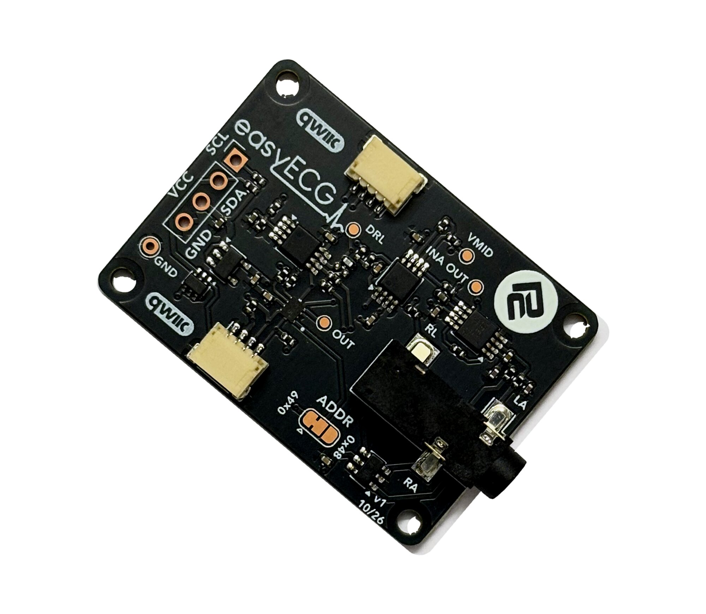

# ProtoCentral easyECG Arduino Library

[](https://github.com/Protocentral/protocentral_easyecg_arduino/actions/workflows/arduino-lint.yml)
[](https://github.com/Protocentral/protocentral_easyecg_arduino/actions/workflows/compile-examples.yml)

Arduino library for the **ProtoCentral easyECG Breakout**: single-lead (Lead I) ECG over I²C / Qwiic, built from discrete parts you can probe. It handles the sampling, filtering and heart-rate detection, and has no external dependencies.

## Don't have one? [Buy it here](https://protocentral.com/product/easyecg-single-lead-ecg-breakout-qwiic/)



## Links

| | |
|---|---|
| Product page | https://protocentral.com/product/easyecg-single-lead-ecg-breakout-qwiic/ |
| Hardware design files | https://github.com/Protocentral/protocentral_easyecg_hardware |
| easyISO isolated Qwiic adapter | https://protocentral.com/product/easyiso-isolated-qwiic-adapter/ |
| easyISO hardware design files | https://github.com/Protocentral/protocentral_easyiso_hardware |
| MicroPython + Raspberry Pi driver | https://github.com/Protocentral/protocentral-micropython-easyecg |
| OpenView companion app | https://github.com/Protocentral/protocentral_openview |
| INA333 datasheet | https://www.ti.com/lit/ds/symlink/ina333.pdf |
| OPA2333 datasheet | https://www.ti.com/lit/ds/symlink/opa2333.pdf |
| TLA2024 datasheet | https://www.ti.com/lit/ds/symlink/tla2024.pdf |

## How it works

The board uses the same circuit as the [easyEMG](https://github.com/Protocentral/protocentral_easyemg_arduino), with ECG component values. An INA333 and two OPA2333 stages give a total gain of about ×535, fixed by the onboard resistors, and a passband of about 0.5–31 Hz. A TLA2024 12-bit ADC then reads the signal at about 1.87 µV per count at the electrodes.

The analog filter takes only about 6 dB off 50 Hz, so the library does the rest. It samples on a fixed clock, applies a mains notch and a 40 Hz low-pass, then decimates to the output rate.

## Features

- Fixed-rate sampling at 1000 SPS (500 SPS on 8-bit AVR), with 125 or 250 Hz output
- 50/60 Hz notch and 4th-order 40 Hz Butterworth low-pass in software
- No digital high-pass by default, so the ST segment keeps its true shape. This is optional
- Heart rate from a simplified Pan-Tompkins R-peak detector
- Signal-quality flags: amplifier saturation, mains-pickup level and a provisional lead-off heuristic
- Readings converted to µV at the electrodes
- No dependencies. Runs on AVR, Uno R4, Nano 33 BLE, ESP32 and RP2040

> **Not a medical device. For research and education only.** The breakout has no patient isolation: when electrodes are on a person, power the host from a battery or connect through an [easyISO isolated Qwiic adapter](https://protocentral.com/product/easyiso-isolated-qwiic-adapter/). On a mains-powered host, the driven-right-leg amplifier saturates on the host's leakage current. The result is no trace at all, not a noisy one, and the library reports it as `isSaturated()`.

## Installation

- **Arduino Library Manager (recommended):** search for and install **ProtoCentral easyECG**.
- **Manual:** download this repository as a ZIP, then use **Sketch → Include Library → Add .ZIP Library…**

## Wiring

Connect the board with a Qwiic / STEMMA QT cable, or use the header:

| Breakout | MCU |
|---|---|
| VCC | 3.3 V or 5 V (header only; Qwiic is 3.3 V) |
| GND | GND |
| SDA | I²C SDA |
| SCL | I²C SCL |

The default I²C address is **`0x49`**. To move it to **`0x48`**, cut JP1 and bridge 2–3, then use `easyECG ecg(EASYECG_I2C_ADDR_ALT);`.

### Electrode placement

The 3.5 mm jack carries **LA on the sleeve, RA on the ring and RL on the tip**.

| Lead | Chest placement (recommended) | Limb placement |
|---|---|---|
| LA | Below the left collarbone | Left wrist or forearm |
| RA | Below the right collarbone | Right wrist or forearm |
| RL | Lower right abdomen, or over the hip bone | Right leg or ankle |

For a clean trace, wipe the skin with alcohol, use fresh gel electrodes, twist the leads together and sit still.

## Quick Start

```cpp
#include <Wire.h>
#include "ProtoCentral_easyECG.h"

easyECG ecg;

void setup() {
    Serial.begin(115200);
    if (!ecg.begin()) {               // +/-2.048 V, 1000 SPS in, 125 Hz out, 50 Hz notch
        Serial.println("easyECG not found");
        while (1);
    }
    Wire.setClock(400000);
    ecg.calibrateBaseline(1000);      // one second, sitting still
}

void loop() {
    if (ecg.update()) {               // true each time a filtered sample is ready
        Serial.println(ecg.ecgMicrovolts(), 1);
    }
}
```

Call `update()` as often as you can. It takes an ADC sample only when the sample clock is due, and never blocks.

## API Reference

| Method | Description |
|---|---|
| `easyECG(i2cAddress = 0x49)` | `EASYECG_I2C_ADDR_ALT` = 0x48 |
| `bool begin(TwoWire& wirePort = Wire)` | Configure the ADC. True if it ACKs |
| `bool update()` | Non-blocking. True when an output sample is ready |
| `float ecgMicrovolts()` / `int16_t ecgFiltered()` | Filtered output, in µV at the electrodes / in counts |
| `float ecgUnfilteredMicrovolts()` / `int16_t ecgUnfiltered()` | Plain ADC average, in µV / in counts |
| `setSampling(adcRateHz, outputRateHz)` | For example 1000, 125 |
| `setNotch(mainsHz, q = 4.0f)` | 50 or 60. 0 disables |
| `setLowPass(cornerHz)` | Default 40. 0 disables |
| `setHighPass(cornerHz)` | Default 0 (off) |
| `float heartRate()` | bpm, 0 until established |
| `bool beatDetected()` / `lastRRMillis()` | True once per beat / last R-R interval in ms |
| `bool isSaturated()` | Amplifier pinned at a rail |
| `bool isLeadOff()` / `setLeadOffThreshold(uV)` | Saturated, or mains above the threshold / set it |
| `float mainsMicrovolts()` | Mains pickup, µV RMS |
| `calibrateBaseline(durationMs = 1000)` | Measure and subtract the resting offset |
| `missedSamples()` | Samples the loop could not take on time. Should stay 0 |

The full API is documented in [ProtoCentral_easyECG.h](src/ProtoCentral_easyECG.h).

## Lead-off detection

The board has no lead-off comparator, so the library infers lead-off from saturation, or from mains pickup above `setLeadOffThreshold()` (default 200 µV RMS). The default is **provisional**: measure your own with `05.Diagnostics` before relying on it.

## Examples

| # | Sketch | Description |
|---|---|---|
| 01 | `01.BasicReading` | Filtered ECG in counts and µV, 125 times a second |
| 02 | `02.SerialPlotter` | Filtered and unfiltered traces in the Arduino Serial Plotter, 250 Hz |
| 03 | `03.HeartRate` | Heart rate on every beat, LED blink, saturation and lead-off messages |
| 04 | `04.OpenView` | Stream to [OpenView](https://github.com/Protocentral/protocentral_openview) 3.4 or later, using the **easyECG Breakout** profile |
| 05 | `05.Diagnostics` | I²C scan, ADC activity, then noise, mains, R-wave and heart rate every 2 s. **Run this first if something is wrong** |

All examples print at 115200 baud, except `04.OpenView`, which streams at 57600.

## Troubleshooting

Run `05.Diagnostics` first; its header explains how to separate board noise from body noise.

- **Flat line, `sat = Y`:** the host is mains-powered without isolation, or an electrode is off.
- **Small R-wave (under 0.5 mV):** limb placement. Move the electrodes to the chest.
- **Busy baseline between beats, small `mains`:** muscle tension or electrode contact. Relax, re-prep the skin and use fresh electrodes.
- **Large `mains`, lead flag set:** a loose electrode, long untwisted leads, or the subject is near a mains cable.
- **`missed` increasing:** `loop()` is doing too much between `update()` calls, or the host is too slow for the ADC rate.
- **Inverted trace:** LA and RA are swapped.

## License

- **Software:** MIT
- **Hardware:** CERN-OHL-P v2
- **Documentation:** CC BY-SA 4.0

See [LICENSE.md](LICENSE.md). Copyright (c) 2026 ProtoCentral Electronics.

## Support

Open an issue on [GitHub](https://github.com/Protocentral/protocentral_easyecg_arduino/issues) or email support@protocentral.com.
